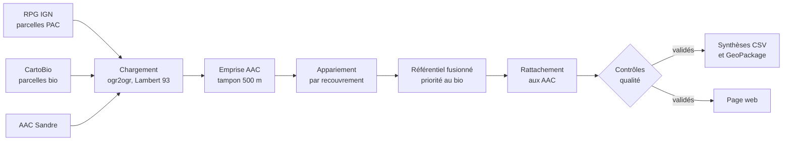

# Cultures et part du bio sur les aires d'alimentation de captage

**Que cultive-t-on sur les terres qui alimentent les captages d'eau potable, et quelle part en agriculture biologique ?**

Ce projet croise trois sources ouvertes dans PostgreSQL/PostGIS : le Registre parcellaire graphique (IGN), les parcelles bio de CartoBio (Agence Bio) et les aires d'alimentation de captage (Sandre). Il produit un référentiel parcellaire unique, des indicateurs par AAC et une page web de restitution.

| Pour aller plus loin | |
|---|---|
| [Page de restitution](https://aymericmld.github.io/aac_partbio/) | Carte, cultures, classement des AAC |
| [Méthodologie détaillée](docs/METHODOLOGIE.md) | Classification, appariement, contrôles et limites |
| [Récupérer les données](docs/DONNEES.md) | Où télécharger chaque source et où la déposer |
| [Comprendre le code](docs/COMPRENDRE_LE_CODE.md) | Visite guidée des scripts, pour qui découvre SQL, PostGIS ou Python |

> **État du projet : premier jet.** Les résultats ont été calculés le 19 novembre 2026 sur le **RPG 2025** (version 4.0), les parcelles CartoBio 2025 et les 1 590 AAC de métropole diffusées par le Sandre. La méthode et la grille de classement des cultures restent à affiner : voir [Pistes d'amélioration](#pistes-damélioration).

## En bref

- **7,8 %** de la surface agricole des AAC est en bio ou en conversion, soit 257 000 ha sur 3,28 millions.
- À base égale, le RPG constate **7,7 %** de bio sur les parcelles qui touchent une AAC, contre **10,4 %** sur l'ensemble de la métropole.
- Les **céréales et oléoprotéagineux** couvrent 61 % de la surface agricole des AAC, mais seulement 4,4 % en bio.
- Une AAC sur quatre n'a **aucune parcelle bio** ; la moitié en compte moins de 3,6 %.

## La méthode



1. **Classer.** Les codes cultures du RPG et de CartoBio sont rattachés à 8 catégories communes, par groupe puis par exceptions ligne à ligne.
2. **Délimiter.** Les AAC sont nettoyées et élargies de 500 m pour sélectionner les parcelles à apparier.
3. **Apparier.** Chaque parcelle bio est comparée aux parcelles du RPG qu'elle chevauche. Une parcelle RPG couverte à au moins 50 % par du bio est remplacée.
4. **Rattacher.** Les parcelles sont coupées aux limites des AAC, sans double compte entre AAC superposées.
5. **Contrôler.** Sept contrôles bloquants et un rapport de diagnostics accompagnent chaque exécution.

## Les résultats

### Des AAC très agricoles, moins bio que la moyenne

Les 1 590 AAC couvrent 5,6 millions d'hectares, une fois retirées les superpositions. Les parcelles agricoles en occupent 3,28 millions, soit 58 %. Sur cette surface, 257 000 ha sont en bio ou en conversion : 7,8 %. Environ 229 000 ha sont certifiés AB, 18 000 ha en conversion et 10 000 ha sont constatés bio dans le RPG sans figurer dans CartoBio.

La comparaison avec le reste du territoire se fait à base égale, sur l'attribut « constatée bio » du RPG 2025 : 7,7 % sur les parcelles qui touchent une AAC, contre 10,4 % sur les 27,8 millions d'hectares du RPG métropolitain. Les AAC sont donc moins engagées en bio que la moyenne, alors que l'enjeu de qualité de l'eau y est le plus direct.

### Les grandes cultures dominent et restent peu converties

| Catégorie | Surface dans les AAC | Part du total | Part bio |
|---|---|---|---|
| Céréales et oléoprotéagineux | 1 987 000 ha | 61 % | 4,4 % |
| Prairies | 711 000 ha | 22 % | 11,6 % |
| Autres | 273 000 ha | 8 % | 10,8 % |
| Vignes | 121 000 ha | 4 % | 11,1 % |
| Cultures fourragères | 115 000 ha | 4 % | 31,0 % |
| Maraîchage | 52 000 ha | 2 % | 7,4 % |
| Cultures fruitières | 12 000 ha | < 1 % | 33,8 % |
| Plantes à parfum, aromatiques et médicinales | 5 000 ha | < 1 % | 24,5 % |

Les céréales et oléoprotéagineux dominent dans 1 175 AAC sur 1 590. C'est aussi la catégorie la moins convertie : le principal gisement de surface pour le bio se trouve là.

### De fortes disparités entre AAC

29 AAC n'ont aucune parcelle agricole connue et 39 en ont moins de 10 ha : sur ces dernières, une seule parcelle suffit à faire basculer la part de bio, elles sont donc signalées sur la page. Parmi les 1 522 AAC qui comptent au moins 10 ha agricoles :

- 385, soit une sur quatre, n'ont aucune parcelle bio ;
- la part bio médiane est de 3,6 % ;
- 461 ont au moins 10 % de bio, et 50 au moins 50 %.

Quelques très grandes AAC, qui couvrent des bassins versants entiers, pèsent lourd : les dix AAC les plus agricoles rassemblent environ un tiers de la surface agricole additionnée AAC par AAC.

### Des AAC qui se superposent

Les AAC ne forment pas un découpage : 724 d'entre elles, soit 46 %, chevauchent au moins une autre AAC (816 paires), par exemple quand deux captages voisins partagent une partie de leur bassin. En conséquence, 136 000 parcelles sur 1,14 million touchent plusieurs AAC.

Les chiffres par AAC comptent chaque parcelle dans toutes les AAC qu'elle touche, ce qui est voulu : chaque captage est concerné. Les totaux, eux, ne comptent chaque surface qu'une fois. Additionnée AAC par AAC, la surface agricole atteindrait 3,80 millions d'hectares au lieu de 3,28, soit 16 % de trop ; la surface des AAC, 6,41 millions au lieu de 5,60.

### Qualité du croisement

| Indicateur | Valeur |
|---|---|
| Parcelles bio retrouvées dans le RPG | 96,3 % |
| Chevauchement résiduel entre parcelles conservées | 304 ha, soit 0,01 % de la surface |
| Surface sans catégorie | 3 ha |
| Catégorie identique entre CartoBio et le RPG sur les parcelles appariées | 85,7 % de la surface |

Les règles de classement codées reproduisent exactement les référentiels classés à la main lors de la conception de la grille : 144 codes PAC sur 144 et 285 codes CPFBIO sur 285. L'écart de concordance vient donc de la grille elle-même. Deux cas expliquent l'essentiel : les surfaces pastorales collectives, classées « Autres » côté CPFBIO mais « Prairies » côté PAC (environ 18 000 ha), et les mélanges de céréales ou de légumineuses, classés en céréales dans CPFBIO et en fourrage dans le RPG. Aligner ces deux cas est la première piste d'amélioration ci-dessous.

### Fichiers produits

| Fichier | Contenu |
|---|---|
| [`synthese_aac.csv`](data/processed/synthese_aac.csv) | Une ligne par AAC : surface agricole, surfaces bio, AB et en conversion, part bio, culture dominante |
| [`synthese_categorie.csv`](data/processed/synthese_categorie.csv) | Surface agricole et bio par catégorie |
| [`synthese_nationale.csv`](data/processed/synthese_nationale.csv) | Indicateurs clés de l'année |
| [`rapport_qualite_2025.json`](data/processed/rapport_qualite_2025.json) | Diagnostics détaillés du croisement |
| `parcel_aac_2025.gpkg` | Parcelles rattachées aux AAC, pour QGIS (option `--gpkg`, non versionné) |

## Reproduire

Prérequis : Python 3.11 ou plus, PostgreSQL avec PostGIS, GDAL (`ogr2ogr`).

```bash
python3 -m venv .venv
```

```bash
.venv/bin/pip install -e '.[dev]'
```

```bash
cp .env.example .env
```

Renseigner la connexion PostgreSQL dans `.env`, déposer les sources selon [DONNEES.md](docs/DONNEES.md), puis :

```bash
.venv/bin/python -m aac_partbio tout --annee 2025 --gpkg
```

Le projet ne porte aujourd'hui que sur 2025. Le code accepte une autre année avec l'option `--annee` ; pour suivre une évolution sur le même périmètre d'AAC, il faudrait la traiter sans recharger les AAC (par exemple 2026, une fois publiée) :

```bash
.venv/bin/python -m aac_partbio tout --annee 2026 --sans-aac
```

Sur une machine modeste, le RPG complet (plus de 6 Go) peut d'abord être réduit aux parcelles proches des AAC, sans PostgreSQL. La commande calcule aussi la part bio du RPG complet, reprise ensuite dans les indicateurs :

```bash
.venv/bin/pip install -e '.[prefiltre]'
.venv/bin/python -m aac_partbio.prefiltre --rpg RPG_Parcelles.gpkg --bio cartobio.gpkg --aac AAC.gpkg --sortie data/raw/2025
```

Pour tester la chaîne sans télécharger les sources, le jeu synthétique génère deux années fictives et les traite. Il écrit dans son propre schéma pour ne pas mélanger ses tables aux vraies, et ses sorties vont dans `data/processed/demo/` :

```bash
AAC_SCHEMA=aac_partbio_demo .venv/bin/python -m aac_partbio demo
```

La démo réécrit aussi `docs/data/` : relancer `exporter` après une exécution réelle pour remettre la page sur les vraies données.

Les tests, dont un test d'intégration qui crée une base `aac_partbio_test` :

```bash
.venv/bin/python -m pytest
```

Pour prévisualiser la page :

```bash
python3 -m http.server -d docs
```

| Étape | Commande | Rôle |
|---|---|---|
| `charger` | `python -m aac_partbio charger --annee 2025` | Sources dans PostGIS, référentiels classés |
| `traiter` | `python -m aac_partbio traiter --annee 2025` | Scripts SQL 01 à 07 (`--depuis N` pour reprendre) |
| `controler` | `python -m aac_partbio controler --annee 2025` | Contrôles bloquants et rapport |
| `exporter` | `python -m aac_partbio exporter` | CSV, données du site, GeoPackage avec `--gpkg` |
| `tout` | `python -m aac_partbio tout --annee 2025` | Les quatre étapes |

## Structure

```text
src/aac_partbio/   Chargement, classification, traitement, contrôles, exports, démo
sql/               Sept étapes PostGIS, lisibles et exécutables avec psql
tests/             Tests unitaires et scénario d'intégration
docs/              Page web (GitHub Pages), méthodologie, guide des données
data/reference/    Référentiels de cultures classés (générés au chargement)
data/processed/    Synthèses et rapports qualité
```

Chaque script SQL et chaque module Python commence par un en-tête qui explique son rôle, ce qu'il lit et ce qu'il produit. Pour un ordre de lecture, voir [Comprendre le code](docs/COMPRENDRE_LE_CODE.md).

La page est servie par GitHub Pages depuis le dossier `docs/` de la branche `main` (Settings → Pages → Deploy from a branch → `/docs`).

## Pistes d'amélioration

Ce premier jet pose la chaîne complète ; plusieurs points restent à travailler :

- **Aligner la grille de cultures** sur les deux cas de discordance repérés : surfaces pastorales collectives et mélanges céréales-légumineuses.
- **Tester la sensibilité au seuil de recouvrement** (50 %) : relancer à 30 % et 70 % et comparer les résultats.
- **Ajouter une deuxième année** pour mesurer une évolution sur le même périmètre d'AAC.
- **Croiser avec la qualité de l'eau** mesurée aux captages (nitrates, pesticides), pour passer de l'occupation des sols aux enjeux.
- **Traiter l'outre-mer** avec les fichiers RPG des départements d'outre-mer.

## Compétences démontrées

| Domaine | Mise en œuvre |
|---|---|
| SIG | PostGIS : validation, subdivision, index GiST, intersections et unions, Lambert 93 |
| Appariement | Recouvrement surfacique entre deux référentiels parcellaires, règle de priorité, mesure du résiduel |
| Référentiels | Classification documentée de deux nomenclatures de cultures, contrôle de concordance |
| Qualité | Contrôles bloquants, rapport de diagnostics, scénario de test construit à la main |
| Restitution | Page web Leaflet sans framework, carte choroplèthe, tableau triable |

## Sources

| Source | Producteur | Licence |
|---|---|---|
| [RPG](https://cartes.gouv.fr/rechercher-une-donnee/dataset/IGNF_RPG) | IGN, ASP | Licence Ouverte 2.0 |
| [Parcelles certifiées bio sur CartoBio](https://www.data.gouv.fr/datasets/parcelles-certifiees-en-agriculture-biologique-sur-cartobio) | Agence Bio | À vérifier sur la fiche de la source |
| [Aires d'alimentation de captages](https://www.data.gouv.fr/datasets/aires-dalimentation-de-captages-france-entiere-1) | OFB, Sandre | Licence Ouverte |

## Licence

Le code de ce dépôt est sous [licence MIT](LICENSE). Les données restent soumises aux licences de leurs producteurs. Leaflet est inclus sous sa propre licence BSD (`docs/assets/vendor/leaflet/LICENSE`).
