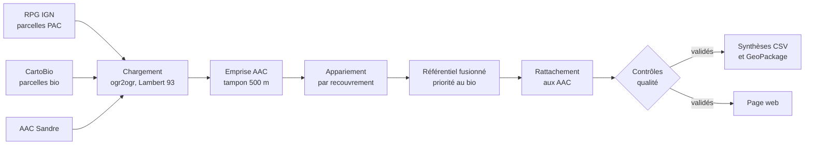

# Cultures et part du bio sur les aires d'alimentation de captage

**Que cultive-t-on sur les terres qui alimentent les captages d'eau potable, et quelle part en agriculture biologique ?**

Ce projet croise trois sources ouvertes dans PostgreSQL/PostGIS : le Registre parcellaire graphique (IGN), les parcelles bio de CartoBio (Agence Bio) et les aires d'alimentation de captage (Sandre). Il produit un référentiel parcellaire unique, des indicateurs par AAC et une page web de restitution.

| Pour aller plus loin | |
|---|---|
| [Page de restitution](https://aymericmld.github.io/aac_partbio/) | Carte, cultures, classement des AAC, évolution |
| [Méthodologie détaillée](docs/METHODOLOGIE.md) | Classification, appariement, contrôles et limites |
| [Récupérer les données](docs/DONNEES.md) | Où télécharger chaque source et où la déposer |

> **État du projet :** la chaîne est mise à jour pour le **RPG 2025** (version 4.0, publiée en octobre 2026) et testée de bout en bout sur un jeu synthétique. La page publiée affiche ces données de démonstration, signalées par un bandeau, jusqu'à la première exécution sur les sources officielles.

## Ce qui a changé depuis la version 2024

- **Données 2025.** RPG 2025, parcelles CartoBio mises à jour en juin 2026, extraction courante des AAC. Le RPG 4.0 porte désormais l'attribut « constatée bio », utilisé pour compléter CartoBio et pour comparer les AAC au reste du territoire.
- **Appariement par recouvrement.** La parcelle RPG au centroïde le plus proche est remplacée par une mesure de la surface réellement commune, ce qui supprime des doubles comptes. Voir la [méthodologie](docs/METHODOLOGIE.md#43-appariement-par-recouvrement).
- **Surfaces justes dans les AAC.** Seule la partie d'une parcelle située dans l'AAC est comptée, et une parcelle à cheval sur deux AAC n'est comptée qu'une fois au total.
- **Multicultures CartoBio.** Les parcelles à plusieurs codes cultures reçoivent la catégorie de leur première culture au lieu de rester sans catégorie.
- **Script découpé et paramétré.** Le script unique devient sept étapes SQL relançables, pilotées par une ligne de commande Python, avec contrôles qualité bloquants et tests. Le script d'origine est conservé dans [`legacy/`](legacy/parcel_2024.sql).

## La méthode



1. **Classer.** Les codes cultures du RPG et de CartoBio sont rattachés à 8 catégories communes, par groupe puis par exceptions ligne à ligne.
2. **Délimiter.** Les AAC sont nettoyées et élargies de 500 m pour sélectionner les parcelles à apparier.
3. **Apparier.** Chaque parcelle bio est comparée aux parcelles du RPG qu'elle chevauche. Une parcelle RPG couverte à au moins 50 % par du bio est remplacée.
4. **Rattacher.** Les parcelles sont coupées aux limites des AAC, sans double compte entre AAC superposées.
5. **Contrôler.** Sept contrôles bloquants et un rapport de diagnostics accompagnent chaque millésime.

## Les résultats

Les indicateurs sont produits dans `data/processed/` et sur la [page de restitution](https://aymericmld.github.io/aac_partbio/) :

| Fichier | Contenu |
|---|---|
| `synthese_aac.csv` | Une ligne par AAC et millésime : surface agricole, surfaces bio, AB et en conversion, part bio, culture dominante |
| `synthese_categorie.csv` | Surface agricole et bio par catégorie de culture |
| `synthese_nationale.csv` | Indicateurs clés par millésime |
| `rapport_qualite_AAAA.json` | Taux d'appariement, chevauchement résiduel, concordance des catégories, codes non classés |
| `parcel_aac_AAAA.gpkg` | Parcelles rattachées aux AAC, pour QGIS (option `--gpkg`, non versionné) |

Ils seront commentés ici après l'exécution sur les données 2025.

## Reproduire

Prérequis : Python 3.11 ou plus, PostgreSQL avec PostGIS, GDAL (`ogr2ogr`).

```bash
python3 -m venv .venv
```

```bash
.venv/bin/pip install -e '.[dev]'
```

```bash
cp .env.example .env
```

Renseigner la connexion PostgreSQL dans `.env`, déposer les sources selon [DONNEES.md](docs/DONNEES.md), puis :

```bash
.venv/bin/python -m aac_partbio tout --annee 2025 --gpkg
```

Pour comparer deux millésimes sur le même périmètre, traiter aussi 2024 sans recharger les AAC :

```bash
.venv/bin/python -m aac_partbio tout --annee 2024 --sans-aac
```

Pour tester la chaîne sans télécharger les sources, le jeu synthétique génère deux millésimes et les traite. Il écrit dans son propre schéma pour ne pas mélanger ses tables aux vraies, et ses sorties vont dans `data/processed/demo/` :

```bash
AAC_SCHEMA=aac_partbio_demo .venv/bin/python -m aac_partbio demo
```

La démo réécrit aussi `docs/data/` : relancer `exporter` après une exécution réelle pour remettre la page sur les vraies données.

Les tests, dont un test d'intégration qui crée une base `aac_partbio_test` :

```bash
.venv/bin/python -m pytest
```

Pour prévisualiser la page :

```bash
python3 -m http.server -d docs
```

| Étape | Commande | Rôle |
|---|---|---|
| `charger` | `python -m aac_partbio charger --annee 2025` | Sources dans PostGIS, référentiels classés |
| `traiter` | `python -m aac_partbio traiter --annee 2025` | Scripts SQL 01 à 07 (`--depuis N` pour reprendre) |
| `controler` | `python -m aac_partbio controler --annee 2025` | Contrôles bloquants et rapport |
| `exporter` | `python -m aac_partbio exporter` | CSV, données du site, GeoPackage avec `--gpkg` |
| `tout` | `python -m aac_partbio tout --annee 2025` | Les quatre étapes |

## Structure

```text
src/aac_partbio/   Chargement, classification, traitement, contrôles, exports, démo
sql/               Sept étapes PostGIS, lisibles et exécutables avec psql
tests/             Tests unitaires et scénario d'intégration
docs/              Page web (GitHub Pages), méthodologie, guide des données
data/reference/    Référentiels de cultures classés (générés au chargement)
data/processed/    Synthèses et rapports qualité
legacy/            Script SQL de la version 2024
```

La page est servie par GitHub Pages depuis le dossier `docs/` de la branche `main` (Settings → Pages → Deploy from a branch → `/docs`).

## Compétences démontrées

| Domaine | Mise en œuvre |
|---|---|
| SIG | PostGIS : validation, subdivision, index GiST, intersections et unions, Lambert 93 |
| Appariement | Recouvrement surfacique entre deux référentiels parcellaires, règle de priorité, mesure du résiduel |
| Référentiels | Classification documentée de deux nomenclatures de cultures, contrôle de concordance |
| Qualité | Contrôles bloquants, rapport de diagnostics, scénario de test construit à la main |
| Restitution | Page web Leaflet sans framework, carte choroplèthe, tableau triable, évolution entre millésimes |

## Sources

| Source | Producteur | Licence |
|---|---|---|
| [RPG](https://cartes.gouv.fr/rechercher-une-donnee/dataset/IGNF_RPG) | IGN, ASP | Licence Ouverte 2.0 |
| [Parcelles certifiées bio sur CartoBio](https://www.data.gouv.fr/datasets/parcelles-certifiees-en-agriculture-biologique-sur-cartobio) | Agence Bio | À vérifier sur la fiche de la source |
| [Aires d'alimentation de captages](https://www.data.gouv.fr/datasets/aires-dalimentation-de-captages-france-entiere-1) | OFB, Sandre | Licence Ouverte |

## Licence

Le code de ce dépôt est sous [licence MIT](LICENSE). Les données restent soumises aux licences de leurs producteurs. Leaflet est inclus sous sa propre licence BSD (`docs/assets/vendor/leaflet/LICENSE`).
