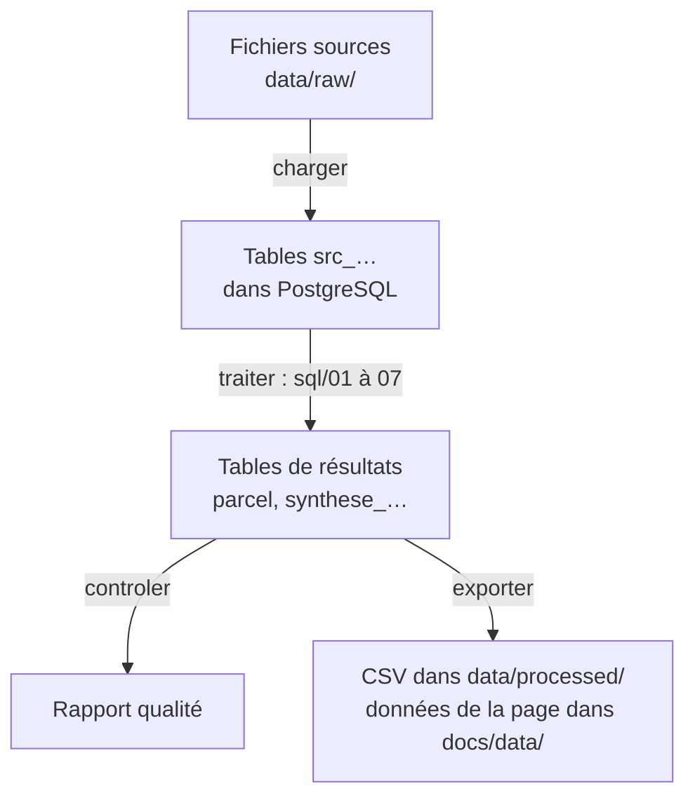

# Comprendre le code

Ce guide est une visite du projet pour quelqu'un qui découvre SQL, PostGIS ou Python. Il explique dans quel ordre lire les fichiers, ce que fait chacun, et les quelques notions à connaître pour les suivre. Le détail des choix de méthode est dans la [méthodologie](METHODOLOGIE.md).

## 1. L'idée en une phrase

On superpose trois cartes : les parcelles agricoles déclarées à la PAC (RPG), les parcelles en agriculture biologique (CartoBio) et les aires d'alimentation de captage (AAC). Pour chaque AAC, on mesure ensuite la surface de chaque culture et la part de bio.

## 2. Les notions à connaître

| Notion | En deux mots |
|---|---|
| **AAC** | Aire d'alimentation de captage : la zone dont l'eau, en s'infiltrant ou en ruisselant, rejoint un captage d'eau potable. |
| **RPG** | Registre parcellaire graphique : le dessin de toutes les parcelles déclarées par les agriculteurs pour les aides de la PAC, avec leur culture. Publié chaque année par l'IGN. |
| **CartoBio** | La carte des parcelles certifiées en agriculture biologique ou en conversion, publiée par l'Agence Bio. |
| **Millésime** | L'année des données : RPG 2025, CartoBio 2025. |
| **Conversion** | Une parcelle passe trois ans « en conversion » (C1, C2, C3) avant d'être certifiée bio (AB). |
| **PostgreSQL** | Une base de données : un logiciel qui stocke des tables et répond à des requêtes SQL. |
| **PostGIS** | Une extension de PostgreSQL qui ajoute les géométries (points, lignes, polygones) et les calculs dessus : surface, intersection, distance… Ses fonctions commencent par `ST_`. |
| **Lambert 93 (EPSG:2154)** | La projection officielle de la France métropolitaine. Les coordonnées sont en mètres, donc les surfaces en m² : on divise par 10 000 pour avoir des hectares. |
| **WGS 84 (EPSG:4326)** | Le système des coordonnées GPS, en degrés. Utilisé seulement pour la carte web. |
| **GeoPackage (.gpkg)** | Un format de fichier qui contient des données géographiques, comme un shapefile en un seul fichier. |
| **Index spatial (GiST)** | Un index qui range les géométries par position. Il permet de trouver vite les objets proches sans tout comparer. |
| **Schéma** | Un « dossier » de tables dans la base. Toutes les tables du projet sont dans le schéma `aac_partbio`. |

## 3. Le parcours des données



Tout se lance avec une seule commande, `python -m aac_partbio tout --annee 2025`, qui enchaîne les quatre étapes. Chacune peut aussi être lancée seule : `charger`, `traiter`, `controler`, `exporter`.

## 4. Dans quel ordre lire les fichiers

### Étape 0 : le point d'entrée

| Fichier | Rôle |
|---|---|
| [`src/aac_partbio/__main__.py`](../src/aac_partbio/__main__.py) | Lit la commande tapée et appelle les modules dans l'ordre. C'est le meilleur point de départ : il montre l'enchaînement complet en une trentaine de lignes. |
| [`src/aac_partbio/config.py`](../src/aac_partbio/config.py) | Tous les réglages en un seul endroit : dossiers, seuils, noms de colonnes attendus. |

### Étape 1 : charger

| Fichier | Rôle |
|---|---|
| [`chargement.py`](../src/aac_partbio/chargement.py) | Copie les fichiers dans PostgreSQL avec l'outil `ogr2ogr`, puis repère le nom réel des colonnes. |
| [`classification.py`](../src/aac_partbio/classification.py) | Range chaque code culture dans l'une des 8 catégories du projet. C'est du Python pur, sans base de données : le plus simple à lire pour commencer. |
| [`db.py`](../src/aac_partbio/db.py) | Petits outils pour parler à la base. |

### Étape 2 : traiter

[`traitement.py`](../src/aac_partbio/traitement.py) exécute les sept scripts du dossier [`sql/`](../sql), dans l'ordre. Chaque script commence par un en-tête « À quoi sert ce script ? / Ce qu'il lit / Ce qu'il crée ».

| Script | Ce qu'il fait |
|---|---|
| `01_aac_emprise.sql` | Nettoie les AAC et trace une zone de travail : les AAC élargies de 500 m. |
| `02_rpg_ign.sql` | Garde les parcelles du RPG situées dans cette zone. |
| `03_rpg_bio.sql` | Fait de même pour les parcelles bio. |
| `04_appariement.sql` | Repère les parcelles présentes dans les deux sources, en mesurant leur surface commune. |
| `05_parcelles.sql` | Fusionne les deux sources en une seule table, sans doublon, en donnant la priorité au bio. |
| `06_rattachement_aac.sql` | Indique dans quelle AAC se trouve chaque parcelle, et pour quelle surface. |
| `07_syntheses.sql` | Calcule les indicateurs : par AAC, par culture, au niveau national. |

### Étape 3 : contrôler

[`qualite.py`](../src/aac_partbio/qualite.py) vérifie des règles qui doivent toujours être vraies, et arrête tout si l'une est violée. Il écrit aussi un rapport de mesures à lire.

### Étape 4 : exporter

[`export.py`](../src/aac_partbio/export.py) écrit les résultats en CSV et prépare les données de la page web.

### Les outils annexes

| Fichier | Rôle |
|---|---|
| [`prefiltre.py`](../src/aac_partbio/prefiltre.py) | Réduit le RPG complet (plus de 6 Go) aux parcelles proches des AAC, pour travailler sur une machine modeste. |
| [`demo.py`](../src/aac_partbio/demo.py) | Fabrique un faux jeu de données pour tester la chaîne en quelques secondes. |
| [`tests/`](../tests) | Les tests automatiques. `test_pipeline.py` construit à la main un petit cas (une dizaine de parcelles de 1 ha ou moins) et vérifie chaque résultat attendu : c'est un bon exemple concret de ce que fait l'appariement. |
| [`docs/index.html`](index.html), [`docs/assets/app.js`](assets/app.js) | La page web, en HTML et JavaScript, sans framework. La carte utilise la bibliothèque Leaflet. |

## 5. Lire un script SQL du projet

Les scripts contiennent des mots qui ne sont pas du SQL standard :

- **`:annee`, `:schema`, `:"t_rpg_ign"`…** sont des variables. Avant d'exécuter le script, `psql` les remplace par les valeurs données par `traitement.py`. Écrite entre guillemets (`:"nom"`), la variable devient un nom de table ou de colonne. Ainsi `:"schema".:"t_rpg_ign"` devient `"aac_partbio"."rpg_ign_2025"`.
- **`CROSS JOIN LATERAL (SELECT …) g`** calcule une valeur une fois par ligne et la nomme (`g.geom`), pour la réutiliser plusieurs fois sans la recalculer.
- **`a && b`** compare seulement les rectangles qui entourent deux géométries. C'est un test grossier mais très rapide, qui profite de l'index spatial, avant le test précis `ST_Intersects`.
- **`DISTINCT ON (x) … ORDER BY x, y DESC`** garde, pour chaque valeur de `x`, la ligne qui a le plus grand `y`.
- **`sum(…) FILTER (WHERE …)`** additionne seulement les lignes qui respectent la condition.

Pour essayer un script à la main, sans passer par Python :

```bash
psql -v schema=aac_partbio -v buffer=500 -v aac_id=cdaac -v "aac_nom_expr=NULL::text" -f sql/01_aac_emprise.sql
```

## 6. Explorer les résultats

Une fois la chaîne exécutée, les tables sont dans PostgreSQL. Quelques requêtes pour commencer :

```sql
-- Les 10 AAC les plus agricoles et leur part de bio
SELECT nom, round(sau_ha) AS sau_ha, round(100 * part_bio, 1) AS pct_bio
FROM aac_partbio.synthese_aac
WHERE annee = 2025
ORDER BY sau_ha DESC
LIMIT 10;

-- Répartition des parcelles selon leur origine
SELECT source, conversion, count(*) AS parcelles, round(sum(surface_ha)) AS ha
FROM aac_partbio.parcel
WHERE annee = 2025
GROUP BY source, conversion
ORDER BY ha DESC;
```

Pour voir les parcelles sur une carte, exporter le GeoPackage (`python -m aac_partbio exporter --gpkg`) et l'ouvrir dans QGIS.
