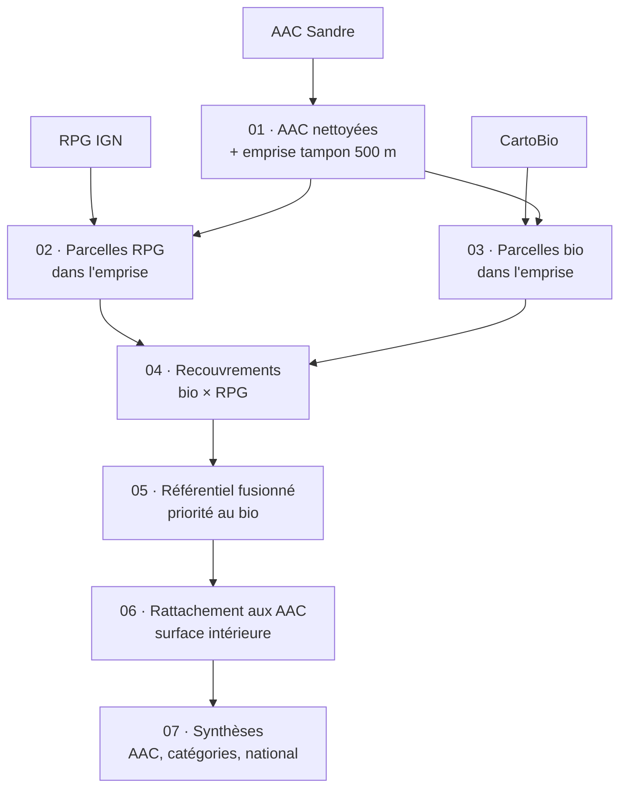

# Méthodologie détaillée

Ce document explique chaque choix du projet : les données retenues, la classification des cultures, l'appariement des deux sources parcellaires et ce que les résultats permettent, ou non, de conclure. Pour une vue d'ensemble, commencer par le [README](../README.md) ; pour télécharger les sources, voir [DONNEES.md](DONNEES.md).

## 1. Question posée

Sur les aires d'alimentation de captage (AAC), quelles cultures trouve-t-on et quelle part est conduite en agriculture biologique ? Une AAC regroupe les surfaces dont l'eau, en s'infiltrant ou en ruisselant, alimente un captage d'eau potable. L'occupation agricole de ces surfaces est donc un levier direct de protection de la ressource.

## 2. Les données

| Source | Producteur | Contenu utilisé | Millésime |
|---|---|---|---|
| RPG Parcelles (version 4.0) | IGN, ASP | Contour, code culture, surface, attribut « constatée bio » | 2025 |
| Parcelles CartoBio | Agence Bio | Contour, culture CPFBIO, niveau de conversion, surface | 2025 |
| Aires d'alimentation de captage | Sandre, OFB | Contour et code de chaque AAC validée | Extraction courante |
| Référentiel des cultures PAC | IGN | Code, libellé et groupe de chaque culture | 2025 |
| Liste des cultures CPFBIO | Agence Bio | Code, libellé, groupe et sous-groupe | Courante |

Les deux sources parcellaires sont complémentaires. Le RPG couvre les surfaces déclarées à la PAC, bio ou non. CartoBio couvre les parcelles certifiées par les organismes certificateurs, y compris celles qui ne sont pas déclarées à la PAC, avec leur niveau de conversion.

### Changement de modèle du RPG en 2025

Jusqu'en 2023, le RPG ne contenait que les parcelles et leur culture. L'édition 2024 a ajouté des couches thématiques séparées. Depuis l'édition 2025 (RPG 4.0), ces informations sont des attributs de la couche Parcelles, dont l'indicateur « constatée bio ». Le pipeline en tire parti de deux façons :

1. une parcelle constatée bio dans le RPG mais absente de CartoBio est comptée en bio, avec le statut `BIO_PAC` ;
2. la part bio du RPG seul est calculée dans les AAC et sur l'ensemble du fichier : c'est une comparaison à base égale entre les AAC et le reste du territoire.

Pour un millésime sans cet attribut, toutes les parcelles du RPG sont considérées comme conventionnelles et ces deux indicateurs restent vides.

## 3. Classification des cultures

Les deux référentiels ont chacun leur nomenclature. Pour les comparer, chaque code est rattaché à l'une de 8 catégories métier.

| Catégorie | Contenu |
|---|---|
| Céréales et oléoprotéagineux | Céréales, oléagineux, protéagineux, légumineuses à grains |
| Cultures fourragères | Plantes cultivées pour l'alimentation animale, hors prairies |
| Prairies | Prairies permanentes et temporaires, parcours, estives et landes |
| Cultures fruitières | Vergers, fruits à coque, oliviers, petits fruits |
| Maraîchage | Légumes, cultures potagères, horticulture ornementale |
| Vignes | Viticulture |
| Plantes à parfum, aromatiques et médicinales | PPAM et plantes à boisson (houblon, café, thé…) |
| Autres | Cultures industrielles non oléagineuses, jachères, surfaces non productives, éléments paysagers… |

### Règles

1. **Par groupe.** Chaque groupe du référentiel (groupe PAC, groupe et sous-groupe CPFBIO) est rattaché à une catégorie selon son sens agronomique.
2. **Exceptions ligne à ligne.** Les groupes hétérogènes sont examinés culture par culture.
3. **Repli explicite.** Ce qui ne correspond à aucune catégorie agronomique va dans « Autres ». Un groupe inconnu y va aussi, mais il est signalé au chargement.

Les règles sont codées dans [`classification.py`](../src/aac_partbio/classification.py). Elles portent sur les **libellés** et non sur les codes, pour rester valables quand un millésime ajoute des cultures. Les référentiels classés sont écrits dans `data/reference/` à chaque chargement, pour audit.

### Référentiel PAC

| Groupe PAC | Catégorie |
|---|---|
| Blé tendre, Maïs, Orge, Autres céréales, Colza, Tournesol, Autres oléagineux, Protéagineux, Riz, Légumineuses à grains | Céréales et oléoprotéagineux |
| Fourrage | Cultures fourragères |
| Estives et landes, Prairies permanentes, Prairies temporaires | Prairies |
| Vergers, Fruits à coque, Oliviers | Cultures fruitières |
| Vignes | Vignes |
| Légumes ou fleurs | Maraîchage |
| Plantes à fibres, Gel, Canne à sucre, Divers, Autres cultures industrielles | Autres, avec exceptions |

Exceptions dans « Autres cultures industrielles » et « Divers » : houblon, lavande et lavandin, vanille, persil, fenugrec, plantes médicinales, aromatiques ou à parfum vont en PPAM ; cameline et moutarde vont en Céréales et oléoprotéagineux. Restent en « Autres » : betterave, tabac, chanvre et lin fibre, canne à sucre, jachères, bordures, bandes tampons, taillis, pépinières, truffières, marais salants…

### Référentiel CPFBIO

| Groupe CPFBIO | Catégorie |
|---|---|
| Grandes Cultures | Céréales et oléoprotéagineux |
| Surfaces fourragères, sous-groupe « Prairies, parcours » | Prairies |
| Surfaces fourragères, autres sous-groupes | Cultures fourragères |
| Fruits | Cultures fruitières |
| Légumes | Maraîchage |
| Viticulture | Vignes |
| Plantes à parfums, aromatiques et médicinales et plantes à boissons | PPAM |
| Autres surfaces, Inconnu | Autres, avec exceptions |

Exceptions dans « Autres surfaces » : semences de céréales, légumineuses, oléagineux et riz vont en Céréales et oléoprotéagineux ; plants et semences potagers en Maraîchage ; semences fruitières en Cultures fruitières ; semences de plantes fourragères en Cultures fourragères ; zones de cueillette de PPAM en PPAM.

### Multicultures CartoBio

CartoBio peut associer plusieurs codes à une parcelle, séparés par une virgule. Le script de 2024 joignait la chaîne complète au référentiel : ces parcelles restaient sans catégorie. La première culture déclarée sert désormais de culture principale, et la parcelle garde un indicateur `multiculture`.

### Contrôle de cohérence

Les deux référentiels sont classés séparément. Le rapport qualité mesure la part de surface où la parcelle bio et la parcelle RPG appariée tombent dans la même catégorie, et liste les principales discordances.

### Prompt réutilisable

Le prompt ci-dessous reproduit cette classification sur un nouveau référentiel avec une IA.

```text
Tu es chargé de classer des cultures agricoles dans une des 8 catégories suivantes :
1. Céréales et oléoprotéagineux
2. Cultures fourragères
3. Prairies
4. Cultures fruitières
5. Maraîchage
6. Vignes
7. Plantes à parfum, aromatiques et médicinales (PPAM)
8. Autres

Contexte : ces catégories servent à qualifier des parcelles agricoles à partir d'un
référentiel de cultures (colonnes possibles : code culture, libellé culture, groupe,
sous-groupe, précisions...).

Tâche :
1. Charge le fichier fourni et identifie toutes ses colonnes, notamment celles qui
   décrivent une hiérarchie de classification déjà présente (groupe, sous-groupe, famille...).
2. Si une hiérarchie existe déjà dans le fichier, commence par établir une règle de mapping
   groupe → catégorie cible, en te basant sur le sens agronomique du groupe.
3. Repère les groupes hétérogènes (ex. "Autres cultures industrielles", "Divers", "Autres
   surfaces"). Pour ces groupes uniquement, examine chaque ligne à partir de son libellé
   et affecte la catégorie la plus pertinente, en listant les exceptions retenues.
4. Applique la catégorie "Autres" par défaut aux cultures qui ne correspondent à aucune
   des 7 catégories agronomiques.
5. Ajoute une colonne `categorie` au fichier source (ne modifie aucune autre colonne) et
   exporte le résultat dans le même format que le fichier d'entrée.
6. Vérifie ton travail : distribution du nombre de lignes par catégorie, et détail des
   lignes classées en "Autres" pour validation manuelle.
7. Documente les règles de mapping utilisées (groupe → catégorie, exceptions ligne à ligne).

Contraintes :
- Ne jamais laisser de ligne sans catégorie.
- "Autres" doit rester une catégorie de repli explicite et documentée.
- Si le fichier contient plusieurs référentiels ou onglets, traiter et documenter chacun
  séparément.
```

## 4. Croisement des parcelles

Les traitements sont sept scripts SQL dans [`sql/`](../sql), exécutés par `psql` avec des variables : millésime, noms de colonnes détectés, tampon, seuil. Ils peuvent être relus et lancés seuls.



### 4.1 Emprise

Les AAC sont rendues valides, regroupées par code et projetées en Lambert 93 (EPSG:2154). Un tampon de 500 m sert à sélectionner les parcelles à apparier, y compris celles qui débordent de l'AAC. Le script de 2024 fusionnait toutes les AAC tamponnées en un seul polygone national ; chaque test d'intersection portait alors sur un objet géant. Chaque AAC tamponnée est maintenant découpée en morceaux d'au plus 256 sommets (`ST_Subdivide`), que l'index spatial filtre efficacement.

### 4.2 Préparation

Les géométries sont corrigées (`ST_MakeValid`), réduites à leurs polygones et typées en `MultiPolygon`. La surface graphique est recalculée en Lambert 93 ; la surface déclarée est conservée à côté.

### 4.3 Appariement par recouvrement

C'est le principal changement par rapport à 2024. L'ancien script retenait, pour chaque parcelle bio, la parcelle RPG au **centroïde le plus proche**. Deux erreurs en découlaient :

- une parcelle RPG voisine pouvait être retenue alors qu'une autre chevauchait davantage la parcelle bio ;
- une parcelle RPG recouverte par une parcelle bio, mais qui n'était pas sa « plus proche », restait en plus de la parcelle bio : sa surface était comptée deux fois.

Le traitement mesure désormais la **surface réellement commune** entre chaque parcelle bio et chaque parcelle RPG qu'elle touche.

- **Appariement d'une parcelle bio :** la parcelle RPG de plus fort recouvrement, retenue si la surface commune atteint 50 % de la plus petite des deux. Rapporter à la plus petite permet d'apparier une parcelle découpée en deux dans CartoBio.
- **Remplacement d'une parcelle RPG :** elle est remplacée si l'ensemble des parcelles bio qui la chevauchent couvre au moins 50 % de sa surface.

Le seuil est réglable dans `config.py` (`SEUIL_RECOUVREMENT`).

### 4.4 Référentiel fusionné

| Cas | Parcelle conservée | `source` | `conversion` |
|---|---|---|---|
| Parcelle bio appariée | Parcelle bio | `cartobio_rpg` | AB, C1, C2 ou C3 |
| Parcelle bio sans équivalent RPG | Parcelle bio | `cartobio_hors_rpg` | AB, C1, C2 ou C3 |
| Parcelle RPG constatée bio, non couverte par CartoBio | Parcelle RPG | `rpg` | `BIO_PAC` |
| Autre parcelle RPG non remplacée | Parcelle RPG | `rpg` | `CONV` |

La table `parcel` garde une colonne `annee` : plusieurs millésimes y cohabitent, chaque exécution ne remplace que le sien.

### 4.5 Rattachement aux AAC

Une parcelle est rattachée à toute AAC qu'elle chevauche, sans tampon cette fois. Deux corrections par rapport à 2024 :

- **seule la partie intérieure est comptée** : une parcelle à cheval sur la limite n'apporte que sa surface dans l'AAC ;
- **pas de double compte entre AAC** : des AAC voisines peuvent se superposer. Les totaux nationaux utilisent la surface de chaque parcelle dans l'union des AAC qu'elle touche (`parcel_dans_aac`).

Le script de 2024 utilisait une jointure à droite pour garder les AAC sans parcelle. Ces AAC sont désormais conservées dans `synthese_aac`, avec une surface agricole nulle.

### 4.6 Synthèses

| Table | Grain | Principaux indicateurs |
|---|---|---|
| `synthese_aac` | AAC × millésime | Surface de l'AAC, surface agricole, surfaces bio, AB et en conversion, part bio, catégorie dominante |
| `synthese_categorie` | Catégorie × millésime | Surface agricole et bio, sans double compte |
| `synthese_nationale` | Millésime | Nombre d'AAC, surfaces, part bio, part bio du RPG seul dans les AAC et sur tout le fichier |

## 5. Contrôles qualité

Les contrôles bloquants arrêtent le pipeline avant toute publication :

1. au moins une parcelle produite ;
2. aucune surface dans une AAC supérieure à la surface de la parcelle ;
3. part bio comprise entre 0 et 1 ;
4. toutes les AAC présentes dans la synthèse ;
5. somme des catégories égale au total national ;
6. surface agricole inférieure à la surface des AAC ;
7. dédoublonnage entre AAC qui ne fait jamais augmenter la surface.

Le rapport `data/processed/rapport_qualite_AAAA.json` ajoute des diagnostics à lire : taux d'appariement des parcelles bio, chevauchement résiduel entre parcelles conservées, concordance des catégories, codes cultures sans catégorie et valeurs de la colonne bio du RPG.

Un test d'intégration construit un scénario à la main (parcelle décalée, parcelle découpée, recouvrement partiel, AAC superposées) et vérifie chaque résultat attendu.

## 6. Limites

- **Couverture.** Les surfaces conventionnelles non déclarées à la PAC n'apparaissent dans aucune source.
- **Référentiel AAC incomplet.** Seules les AAC validées par le Sandre sont diffusées.
- **Arbitrages de classification.** Certains rattachements sont discutables, et les deux référentiels ne sont pas recoupés code à code.
- **Seuil de recouvrement.** Un seuil de 50 % est une convention. Le chevauchement résiduel mesuré permet d'en juger l'effet.
- **Comparaison entre années.** Les identifiants du RPG changent chaque année et le modèle de données a changé en 2025. Les évolutions se lisent en surfaces, sur le même périmètre d'AAC.
- **Occupation n'est pas pratique.** La part de bio ne dit rien des pratiques des parcelles conventionnelles ni de la qualité de l'eau mesurée.
